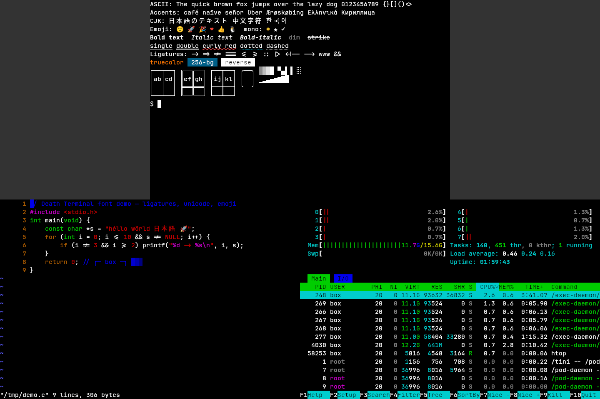

# Fonts



## Pipeline

```
Terminal cells ─▶ Fonts.layoutRow ─▶ Frame (quads) ─▶ Vulkan instanced draw
                    │    ▲                       └─▶ software blit (fallback)
                    ▼    │
              FaceSet ── Atlas (RGBA, shared by both renderers)
```

- **`src/font/face_set.zig`** loads the primary family (Regular, Bold,
  Italic, BoldItalic) with FreeType. A missing style is synthesised
  (`FT_Outline_Embolden` / an oblique transform). Metrics are taken from
  the face: cell width is the advance of `M`, cell height is
  ascent + descent × `line_height`, and the underline and strike
  positions come from `post`/`OS/2`.
- **Fallback**: when the primary face lacks a codepoint, fontconfig
  (`FcFontSort` with a charset) picks the first installed font that has
  it, and the result is cached per codepoint. Emoji-presentation
  characters (wide emoji, or anything followed by VS16) prefer colour
  fonts (`FC_COLOR`), e.g. Noto Color Emoji. Colour bitmaps (CBDT/sbix)
  are scaled to fit the cell span. If nothing covers a codepoint, a
  "missing" box is drawn.
- **`src/font/fonts.zig`** groups each row into runs of cells that share a
  face, shapes them with HarfBuzz (cluster = column), and caches
  rasterised glyphs in the atlas. Ligatures (`calt`, `liga`) are on by
  default. Monospace ligature fonts such as JetBrains Mono keep one
  glyph per cell, so the grid never shifts. Set `font_ligatures = false`
  to turn them off.
- **`src/font/box.zig`** draws box drawing (U+2500–257F), block elements
  (U+2580–259F), braille (U+2800–28FF) and powerline separators
  (U+E0B0–E0B3) procedurally at the exact cell size, so lines join
  seamlessly at any size. The same file provides the curly, dotted and
  dashed underline sprites.
- **`src/font/atlas.zig`** is a shelf-packed, premultiplied RGBA atlas.
  It starts at 512², doubles up to 2048², and is cleared when full; the
  frame is then rebuilt, so eviction is "clear and re-rasterise what is
  visible". Only the dirty rectangle is re-uploaded to the GPU.
- **`src/font/retro.zig`** is the built-in 8×8 bitmap font (`font = retro`).

## Configuration

`~/.config/death-terminal/config.txt`:

```
font_family = JetBrains Mono   # any fontconfig family; empty = bundled
font_size = 11                 # points at 96 DPI, before HiDPI scaling
line_height = 1.0              # cell-height multiplier
font_ligatures = true
# font = retro                 # 8x8 bitmap font
```

Command-line equivalents: `--font retro|default`, `--font-family <name>`,
`--font-size <pt>`, `--line-height <n>`.

If the requested family isn't installed (fontconfig substitutes a
different family), the bundled JetBrains Mono is used instead.

**Zoom**: Ctrl+= (or Ctrl++) and Ctrl+- change the size in 1 pt steps
(5–72 pt); Ctrl+0 resets it. The grid is refitted to the window and the
PTY is resized.

**HiDPI**: pixel size = pt × 96/72 × window scale. The scale comes from
Xft.dpi, the Wayland output scale, or the Win32 DPI, and can be
overridden with `--scale`.

## Bundled font

`assets/fonts/JetBrainsMono/` contains JetBrains Mono v2.304, which is
© The JetBrains Mono Project Authors and licensed under the SIL Open
Font License 1.1 (see `OFL.txt` and `AUTHORS.txt` there). The four TTFs
are embedded in the binary.

## Limitations

- FreeType, HarfBuzz and fontconfig are wired up on Linux only. Other
  platforms currently fall back to the retro font.
- Emoji ZWJ sequences and flag pairs are not composed into a single
  glyph; each codepoint is drawn on its own.
- Ligatures are not split under the cursor.
- The retro font has no bold or italic and covers ASCII plus the
  procedural box/block glyphs only.
