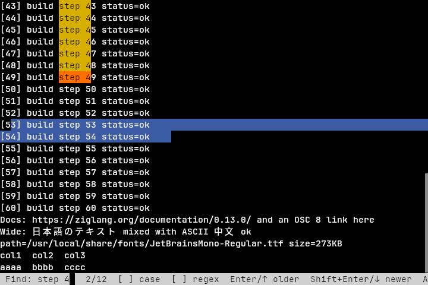

# Selection, clipboard, scrollback and search

## Mouse

| Gesture | Effect |
|---|---|
| Left drag | Select characters (autoscrolls past the top/bottom edge) |
| Double-click | Select a word (letters, digits, non-ASCII and `word_chars`) |
| Triple-click | Select the whole logical line (soft-wrapped rows are joined) |
| Shift+click | Extend the current selection |
| Ctrl+Alt+drag (or Alt+drag) | Rectangular/block selection |
| Middle-click | Paste PRIMARY |
| Ctrl+click | Open the URL or OSC 8 hyperlink under the pointer |
| Wheel | Scroll history on the normal screen (`scroll_lines` per notch); arrow keys / mouse reports in the alternate screen |

If the application turned on mouse reporting (htop, vim `mouse=a`, tmux),
clicks go to the application. Hold **Shift** to select anyway.
Many window managers (xfwm4, GNOME, KDE) grab Alt+drag to move windows, which is
why Ctrl+Alt+drag also starts a block selection.

Selections use absolute line numbers, so they stay on the same text while
output scrolls and while you scroll the view. Wide (CJK/emoji) cells are
always selected whole. Trailing blanks are trimmed; soft-wrapped rows are
copied without a newline. Switching to/from the alternate screen clears the
selection, and so does output that rewrites any selected cell (text that
merely scrolls keeps its selection). A resize that reflows lines clears it
too, because the selected positions move.

Releasing the button copies the selection to PRIMARY (X11/Wayland; emulated
in-process on Windows). With `selection.copy_on_select = true` it is also copied to
CLIPBOARD.

## Keyboard (defaults)

| Keys | Action |
|---|---|
| Ctrl+Shift+C | `copy` selection to CLIPBOARD (with no selection it does nothing: it is never sent to the shell, so it can't act as Ctrl+C) |
| Ctrl+Shift+V | `paste` CLIPBOARD |
| Shift+Insert | `paste_selection` (PRIMARY) |
| Ctrl+Shift+F | `search` |
| Shift+PgUp / Shift+PgDn | `scroll_page_up` / `scroll_page_down` |
| Shift+Home / Shift+End | `scroll_top` / `scroll_bottom` |
| Ctrl+Shift+Up / Down | `scroll_line_up` / `scroll_line_down` |
| Ctrl+Shift+Alt+A | `select_all` (was Ctrl+Shift+A before the AI milestone, which now explains the last error) |
| Ctrl+= / Ctrl+- / Ctrl+0 | `zoom_in` / `zoom_out` / `zoom_reset` |
| Ctrl+Shift+R | `reload_config` (see [CONFIG.md](CONFIG.md)) |
| Ctrl+Shift+S | `ssh_palette`: SSH forwards and profiles (see [SSH.md](SSH.md)) |

Scroll bindings act on the normal screen only; in the alternate screen
(less, vim) the key is passed through to the application, e.g. Shift+PgUp sends
`CSI 5;2~`. Typing returns the view to the bottom.

Rebind in config.lua with `config.keys["chord"] = "action"`; `false` removes a
default (legacy config.txt: `keybind = chord=action`, `chord=none`).
Chords are `+`-joined modifiers (`ctrl`, `shift`, `alt`, `super`) and an X11
keysym name or a single character (`ctrl+shift+c`, `shift+page_up`, `ctrl+=`).
Other actions: `clear_selection`.

## Paste

Pastes are wrapped in `ESC[200~ … ESC[201~` when the application enabled
bracketed paste (?2004); embedded end markers are stripped. When bracketed paste
is off and the text contains a newline, a red bar asks for confirmation
(`y`/Enter pastes, `n`/Esc cancels) — disable with `paste_confirm = false`.

## OSC 52

`osc52 = write` (default) lets programs set CLIPBOARD/PRIMARY with
`ESC]52;c;<base64>ESC\`. `read-write` also answers `ESC]52;c;?` queries with
the clipboard contents; `off` ignores OSC 52. Reading is off by default because
any program (including over SSH) could otherwise read your clipboard.

## Search

Ctrl+Shift+F opens a bar at the bottom (seeded with the selection if any).
Matches in scrollback and on screen highlight as you type; the current match is
orange. Soft-wrapped rows are searched as one line, so a match can continue on
the next row. While the bar is open, matches follow new output: lines already in
history keep their matches, the screen is re-searched after each batch of
output, and the current match stays selected (the view does not jump).

The bar takes the last row. When that row is in use (usually your prompt), the
view moves up one line so the prompt stays visible above the bar; on a screen
with free rows below the prompt nothing moves. In the alternate screen (vim,
less) the bar covers the application's last row.

| Key | Effect |
|---|---|
| Enter / Up / Ctrl+P | Previous (older) match |
| Shift+Enter / Down / Ctrl+N | Next (newer) match |
| Alt+C | Toggle case sensitivity (default: ASCII case-insensitive) |
| Alt+R | Toggle POSIX extended regex (not on Windows) |
| Ctrl+U | Clear query |
| Esc / Ctrl+G / Ctrl+C | Close |

## Links

Ctrl+click on `http(s)://`, `ftp://`, `file://` or `mailto:` text (detected
across soft wraps, trailing punctuation trimmed, parentheses balanced) or on an
OSC 8 hyperlink runs `url_open_command` (default `xdg-open`, `open` on macOS)
with the URL as its only argument — no shell is involved. Other schemes are
refused.

## Config keys

In config.lua (see [CONFIG.md](CONFIG.md)); the legacy config.txt name is in
the last column.

| Option | Default | | config.txt |
|---|---|---|---|
| `selection.copy_on_select` | `false` | Also copy to CLIPBOARD on release | `copy_on_select` |
| `clipboard.paste_confirm` | `true` | Confirm multi-line unbracketed pastes | `paste_confirm` |
| `clipboard.osc52` | `"write"` | `off`, `write`, `read-write` | `osc52` |
| `scrollback.scrollbar` | `true` | Show a scrollbar while scrolled back | `scrollbar` |
| `scrollback.wheel_lines` | `3` | Lines per wheel notch (1–100) | `scroll_lines` |
| `selection.word_chars` | `-_./~:@%+#?&=` | Extra characters that count as part of a word | `word_chars` |
| `links.open_command` | `xdg-open` | Program used for Ctrl+click | `url_open_command` |
| `colors.selection_background` | theme | | `selection_background` |
| `colors.selection_foreground` | theme | `"none"` keeps the text colour | `selection_foreground` |
| `keys["chord"] = "action"` | — | `false` unbinds | `keybind = chord=action` |

## Limitations

- X11: selections larger than the server's maximum request size are refused
  (INCR is supported for receiving, not for sending).
- Search case folding is ASCII only. Regex matches cannot span a hard
  newline.
- The Wayland and Win32 clipboard paths compile but were not tested on real
  compositors / Windows; Ctrl+click does nothing on Windows yet.
