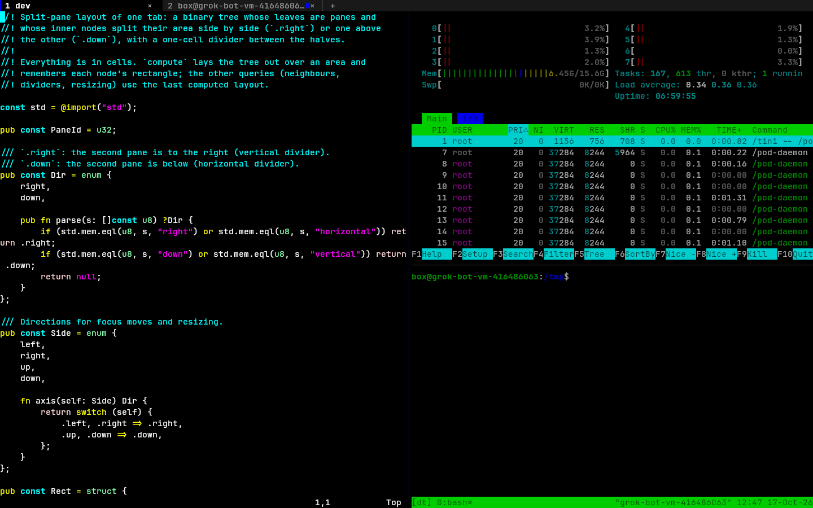

# Tabs and split panes

One window holds any number of **tabs**; each tab is a tree of **split panes**. Every
pane is a full session of its own: its own shell (or SSH session) on its own PTY, its own
grid and scrollback, selection, search, AI suggestions and "explain" context. The palette
(Ctrl+Shift+P), toasts and the status bar belong to the window.



## Keys

| Keys | Action |
|---|---|
| Ctrl+Shift+T | New tab (starts in the focused pane's directory) |
| Ctrl+Shift+Alt+W | Close the tab |
| Ctrl+PgDn / Ctrl+Tab | Next tab |
| Ctrl+PgUp / Ctrl+Shift+Tab | Previous tab |
| Ctrl+Shift+PgUp / PgDn | Move the tab left / right |
| Alt+1 … Alt+9 | Go to tab N |
| Ctrl+Shift+Alt+R | Rename the tab (Enter keeps, Esc cancels, empty = back to the title) |
| Ctrl+Shift+E | Split right (new pane beside the focused one) |
| Ctrl+Shift+O | Split down (new pane below) |
| Ctrl+Shift+W | Close the pane |
| Alt+←/→/↑/↓ | Focus the pane in that direction |
| Alt+Shift+←/→/↑/↓ | Move the focused pane's edge (2 cells per press) |
| Ctrl+Shift+Z | Zoom: the focused pane fills the tab (again to restore) |
| Ctrl+Shift+Alt+E | Equalize the panes of the tab |

`next_pane`, `prev_pane` and `toggle_tab_bar` are unbound by default. Every key can be
changed with `config.keys` (see [CONFIG.md](CONFIG.md)). If an action doesn't apply — Alt+3
with two tabs, Alt+← in the leftmost pane, Ctrl+Tab with one tab — the key goes to the
program as if unbound, so Alt+digits and Alt+arrows still reach the shell and apps there.

## Mouse

- **Tab bar:** click a tab to switch, drag it to reorder, double-click to rename, click `×`
  (or middle-click the tab) to close, `+` opens a new tab, the wheel cycles tabs.
- **Dividers:** drag to resize.
- **Panes:** a click focuses the pane and goes on to it (selection, links, mouse
  reporting). A drag stays with the pane it started in until the button is released.

## Tab bar

The bar shows each tab's number and title (its name if renamed, else the focused pane's
title, else its directory), the directory when the title doesn't mention it, and a
marker before the `×`:

| Marker | Meaning |
|---|---|
| `!` (yellow) | A bell rang in an unfocused pane |
| `✗` (red) | The last command in the tab's focused pane failed (OSC 133 exit status) |
| `…` | A command is running in a background tab |
| `●` (accent) | New output in a hidden pane |

Colours come from the theme (accent = the theme's cursor colour, else palette blue).
`config.tabs.bar` puts it at the `"top"` or `"bottom"`, hides it, or (`"auto"`, the
default) shows it only when there are two or more tabs.

## Directories, SSH

New tabs and panes start in the focused pane's directory as reported by the shell
integration (OSC 7; local `file://` URIs only, and only while the directory exists).
`config.tabs.inherit_cwd = false` starts them in `config.shell.cwd` instead.

In the SSH palette (Ctrl+Shift+S) **Enter** opens a profile in a new tab, **Shift+Enter**
in a split to the right and **Alt+Enter** in a new window. Forwards and Reconnect act on
the focused pane's session. (The profile's `theme` applies to new windows only; tabs
and splits share the window's theme.)

## Closing

A pane closes when its shell exits; the window closes with its last pane. Closing a pane,
tab or the window while a program other than the shell runs there (vim, htop, tmux, a
build…) asks first in a red bar: **y**/Enter closes, **n**/Esc cancels.
`config.tabs.confirm_close = false` turns that off. "Running" is the foreground process
group of the pane's terminal, so a shell sitting at its prompt never asks.

## Dimming

`config.tabs.dim_inactive = 0.35` fades the text of panes without the focus towards the
background (0 = off, up to 0.9). Dividers next to the focused pane use the accent colour.

## Startup layouts

`config.layout` replaces the single startup shell with a list of tabs:

```lua
config.layout = {
  { title = "dev", cwd = "~/src/app", split = "right", ratio = 0.6, panes = {
      { command = "vim", focus = true },
      { split = "down", panes = { { command = "htop" }, { command = "tmux new -A -s dt" } } },
  } },
  { title = "prod", ssh = "work" },
  { cwd = "/var/log" },
}
```

- A **pane** has `cwd`, `command` (typed into the shell once it starts, so the shell's
  history and job control work as usual), `ssh` (a profile, `~/.ssh/config` Host or
  `user@host[:port]`; instead of a shell) and `focus = true` for the pane that gets the
  focus.
- A **split** has `split = "right"` (side by side) or `"down"` (stacked), `panes` (two or
  more; three or more are given equal shares) and `ratio` (first pane's share, 0.05–0.95,
  two panes only). A split's `cwd` is the default for the panes inside it.
- Only the top level takes a `title`. At most 16 tabs and 16 panes per tab.
- `--ssh <target>` ignores `config.layout`.

## Rendering

Each pane composes its own view (scrollback position, selection, search highlights,
ghost text, notices) only when something in it changed; the window grid is then put
together from the panes, dividers, tab bar and overlays, and drawn with one frame build
and one present per frame. Rows that didn't change are not re-uploaded (the renderer's
per-row damage tracking), and with nothing happening the loop sleeps in `poll()` without a
timeout, so idle CPU stays at 0.

## Plugins

Plugins see the focused pane through `dt.term` / `dt.screen` and get events for every
pane (`pane` and `tab` fields in the payloads), plus `tab_new`, `tab_close`, `tab_focus`,
`pane_new`, `pane_close`, `pane_focus`, `dt.tabs.list/new/focus/close/rename` and
`dt.panes.split/focus/close`. See [PLUGINS.md](PLUGINS.md#tabs-and-panes).
